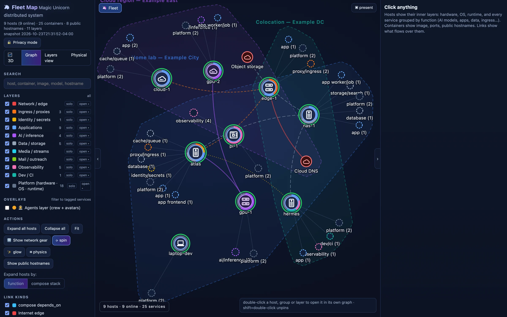
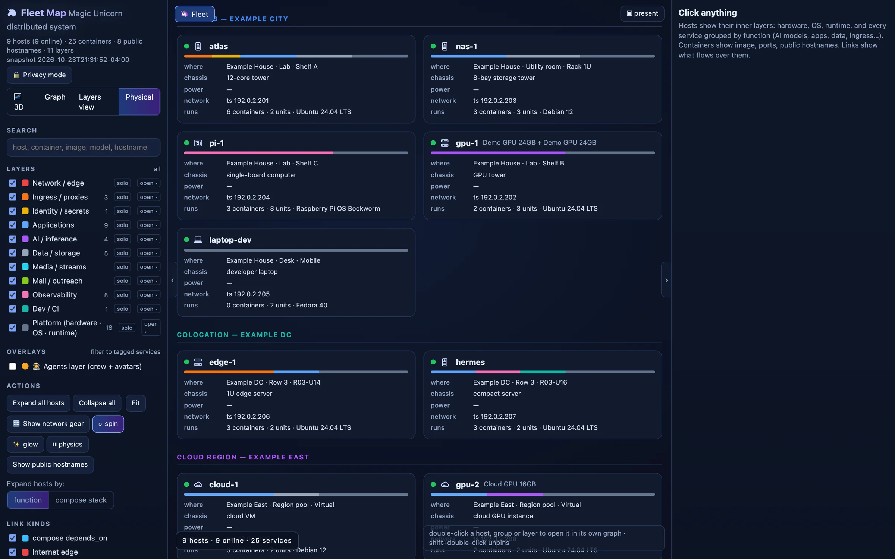
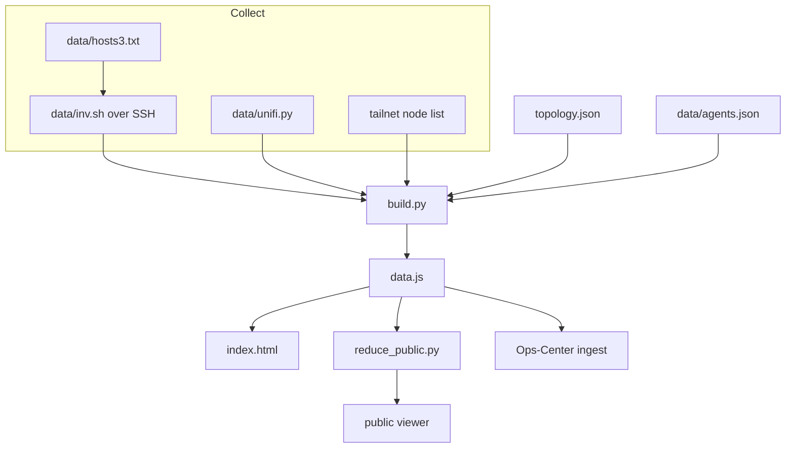

<div align="center">

# fleet-map

Where a fleet's hosts, containers, routes, and agents actually run.

[](LICENSE)


[Quick start](#quick-start) · [Features](#feature-tour) · [Agents](#agents) · [Architecture](#architecture) · [Suite](#part-of-unicorn-commander)

</div>

<p align="center">
  
  <br>
  The fleet map
</p>

## What is fleet-map?

fleet-map is a self-hosted map of a fleet. It draws the machines, the containers and systemd units on them, the routes between them, and the agents that sit on those machines. You keep the shape of the fleet in `topology.json`, and `collect.sh` fills in what is running on the SSH targets in `data/hosts3.txt` by running `data/inv.sh`.

The viewer is one page, `index.html`, with D3 and a vendored 3D view, served as static files. In the Unicorn Commander suite it is the picture of where the other apps run. The snapshot publisher sends the full snapshot to Ops-Center.

## Highlights

- **Four views of one snapshot.** A 3D force graph, a 2D graph, a layer swimlane, and a physical inventory. All four read the same `data.js`.
- **Read-only inventory.** `collect.sh` runs `data/inv.sh` on each host over SSH: OS, logical CPU count, memory, GPUs, addresses, TCP listening ports, Docker containers with compose labels, and selected systemd units. The inventory script does not install or restart anything.
- **Eleven layers.** `build.py` classifies every container and unit into one layer (network, ingress, identity, apps, AI, data, media, mail, observability, dev, platform) so a host opens from hardware down to the service.
- **Agents on the machines that run them.** Each agent is an avatar. Edges go to its seat, voice, wake word, model lane, memory, tools, and channels, coloured by kind; Graph view also styles them by status.
- **The LAN, when you have a controller.** `data/unifi.py` reads a UniFi gateway, switches, access points, ports, and Wi-Fi associations. With no export, LAN lines fall back to the static `lanMembers` list.
- **A privacy toggle, and a reducer that fails closed.** The lock button masks addresses in the browser. `reduce_public.py` prepares a reduced file for publication: it strips fields, scrubs selected text, re-scans the result, and writes nothing if one of its checks still matches.
- **Full and reduced exports.** `deploy/opscenter-push.sh` posts the full snapshot to Ops-Center. `deploy/public-push.sh` publishes only the reduced file.
- **Search that reaches the inventory.** `/` focuses search. Graph and 3D match hosts, container names, images, models, hostnames, and ports. Layers view matches dot names; Physical cards are not filtered by search.

## Feature tour

### The map

<p align="center">
  
  <br>
  The fleet map
</p>

A fresh visit opens the 3D view. A later visit reopens the view you last chose, and `?view=` overrides both. Drag to orbit, scroll to zoom, right-drag to pan, click to select, double-click to open a host. **Graph** is the 2D view in D3, with physics you can pause. Hosts show groups (by function, or by compose stack); click a host or group to expand its services. Drag a node to pin it. Shift-double-click a pinned node to release it.

`?view=3d`, `?view=graph`, `?view=lanes`, or `?view=phys` picks a view. `?layer=` and `?host=` deep links switch to Graph unless `?view=3d` is set. `[` and `]` collapse the side panels, `\` toggles both, and `P` is presentation mode (`Esc` leaves it). In Graph view, service icons use embedded SVGs when available, then the [dashboard-icons](https://github.com/homarr-labs/dashboard-icons) set when the browser is online; a failed icon leaves the coloured circle.

The lines:

| Kind | Meaning |
|---|---|
| `dep` | compose `depends_on` |
| `edge` | Internet edge |
| `route` | Traefik route to an upstream |
| `auth` | SSO / Keycloak |
| `lane` | Inference lane |
| `stream` | Audio or video stream |
| `mail` | Mail |
| `storage` | Backups / git |
| `tailnet` | Tailnet membership |
| `lan` | LAN wired port |
| `wifi` | LAN Wi-Fi association |
| `uplink` | Switch or AP uplink |
| `url` | Public hostname |
| `member` | Host, group, container |
| `agent` | Agent to one of its pieces |

Hand-drawn links live in `topology.json` as `{ "s", "t", "k", "l" }`. In the fleet overview, `k` must be a recognised link kind mapped by `linkLayer` to an enabled layer. Tailnet lines come from `tailnetMembers`. LAN lines come from UniFi when `data/unifi.json` exists, and from `lanMembers` otherwise.

### Inventory

<p align="center">
  
  <br>
  The inventory
</p>

**Physical** is a card per host, grouped by site: chassis, where it sits (`physical.building`, `physical.room`, `physical.rack_or_shelf`), power, how many containers and units it runs, and a bar of its layers. Click a card and the right-hand panel shows that host's recorded hardware, OS, public hostnames, and service layers.

A container's panel shows image, compose stack, health, published ports, and hostnames. A link's panel shows what the line is for. **Layers view** is a swimlane: one column per visible host, one row per enabled layer except network, and dots for services plus OS and GPU entries. The network layer opens as its own graph.

Host glyphs (rack, tower, mini, pi, laptop, mac, vps, panel) are inferred from the chassis and role. Set `hosts.<id>.glyph` to override the symbol. `hosts.<id>.icon` supplies a custom image in Graph view.

### Layers

`topology.json` defines the layers. `build.py` uses ordered rules on container names and images, or unit names, with explicit ingress/platform overrides and an `apps` fallback.

| Id | Label |
|---|---|
| `network` | Network / edge |
| `ingress` | Ingress / proxies |
| `identity` | Identity / secrets |
| `apps` | Applications |
| `ai` | AI / inference |
| `data` | Data / storage |
| `media` | Media / streams |
| `mail` | Mail / outreach |
| `observability` | Observability |
| `dev` | Dev / CI |
| `platform` | Platform (hardware, OS, runtime) |

Four overlays in the same file (`saas-platform`, `saas-inference`, `prod`, `dogfood`) filter or dim services and hosts according to tags, with special handling for external nodes and link kinds. `build.py` applies those tags from container names, images, hostnames, and a host-id list written for the fleet this repository maps. On another fleet the layer colours still work. Edit the tag rules in `build.py` if you want the same filters.

### Agents

`data/agents.json` is the roster. `build.py` resolves pieces to known hosts or external nodes, and to a matching container or systemd unit when possible; an unknown host drops the piece. The viewer uses avatars from `assets/agents/` and connects pieces to visible targets, merging edges with the same target and kind.

| Kind | What the edge means |
|---|---|
| `seat` | Where the agent's process runs |
| `voice` | TTS, STT, and the voice relay |
| `wake` | Wake word |
| `lane` | Which model answers, through which gateway |
| `memory` | Durable memory |
| `tool` | Tools and MCP servers the agent calls |
| `channel` | Rooms and surfaces it speaks on |

In Graph view, a solid edge is `live`, a dashed edge is `configured`, a dotted edge is `unverified`. Status comes from the roster, with omitted statuses defaulting to `live`. The layer starts off. Turn it on with the checkbox, or open `?layer=agents`. Guest-tier agents stay hidden until the guest checkbox is on. In the graph view, hover an avatar to isolate its edges. Click it for the piece list. The picture is drawn from `data.js`. Turning the layer on does not call the agents.

### Network

`data/unifi.py` logs in to a UniFi OS controller and issues read-only GETs for devices, clients, networks, and SSIDs. It writes `data/unifi.json`. `build.py` matches LAN clients to fleet hosts by MAC, then IP, then name, and records their switch-port or access-point attachments when found.

**Show network gear** draws the gateway, switches, and APs on the fleet graph. Opening the network layer lists VLANs and SSIDs; selecting a device shows its ports in use. The script logs in with a POST, reads inventory with GETs, and exports selected fields after removing `x_*` secret fields. With `UNIFI_PASS` unset it exits 1 without changing an existing `data/unifi.json`; `build.py` keeps using that export if present and usable, otherwise the viewer falls back to `lanMembers`.

### Publishing a redacted copy

The lock button (or `?privacy=1`) masks IP/MAC strings and configured names in formatted labels, hides selected port and route fields, and uses short labels in site headings. That is a view of the file. `data.js` on disk is unchanged, which is why it is gitignored.

`reduce_public.py` is the gate before serving a public snapshot. It reads `window.FLEET = {...}` and writes a new file that:

- drops host addresses, the tailnet address, the public address, listening ports, UniFi attachment, file-provider routes, physical location, and last-seen
- clears container ports, and filters host/container hostname lists and route hostnames to `privacy.ownDomains`
- reduces retained file-provider route targets to a host id or `[upstream]`, and drops external-node notes
- sets `network` to null, removing UniFi devices and clients; static topology links and membership lists remain
- drops guest-tier agents, avatar notes, Stable usernames, and piece notes, and strips parentheticals from piece labels
- replaces host ids using `privacy.replace`
- publishes the short site label, and publishes empty `redact` and `replace` tables so the lists themselves are not in the file
- scrubs remaining string keys and values except values under `generatedAt`, `color`, and `avatar`: replace-map text, MAC/IPv4/IPv6 patterns, recognised hostnames outside `ownDomains` and the built-in `PUBLIC_HOSTS` allowlist, redact patterns, two-to-five-digit `:port` suffixes, and lowercase hex runs of seven or more characters

It then checks the output for IPv4/MAC patterns, redact patterns, original replace-map keys, and recognised hostnames outside its allowlists. Any hit exits 2 without updating the destination file. `deploy/public-push.sh` treats that as "publish nothing".

`deploy/build-public-viewer.py` patches `index.html` into a public viewer: privacy forced on, the lock button hidden, saved privacy preferences and `?privacy=` ignored, agents on unless `?layer=off`, hosts with containers or units expanded by default (`?expand=off` collapses them), a canonical link to <https://magicunicorn.tech/fleet/>, and `<meta name="robots" content="index,follow">`. Data loads from `data/data.js` with a cache-buster that changes every five minutes. The script copies D3, the 3D bundle, and crew avatars. Guest avatar files listed in the roster are not copied. Each patch must match exactly once; an unmatched or repeated patch stops the build.

To add a name that must not appear on the public map, edit `privacy.redact` or `privacy.replace` in `topology.json`. A pattern that still matches after the scrub stops the publish.

## Quick start

Building the snapshot uses Python 3's standard library. `serve.sh` also needs Bash; viewing the files needs a browser, with WebGL 2 for 3D. D3 and the 3D bundle are included in the clone.

```bash
git clone https://github.com/Unicorn-Commander/fleet-map.git
cd fleet-map
python3 build.py
./serve.sh
```

Open <http://127.0.0.1:8765/>. `./serve.sh` serves this directory with `python3 -m http.server` on all interfaces, on port 8765. Pass another port as the first argument (`./serve.sh 8876`).

### Try it with the demo fleet

From the repository root, build and serve the fictional fleet with one command:

```bash
python3 build.py --data-dir examples/demo-fleet --out examples/demo-fleet/data.js && python3 -m http.server 8765 --directory examples/demo-fleet
```

Open <http://127.0.0.1:8765/index.html>.

`build.py` writes `data.js` next to `index.html`. The page loads that file. A fresh clone has no collected inventory files, so the first build contains the committed hosts, sites, links, and agent roster, with no collected containers or units. `.gitignore` already excludes `data.js`. Leave it untracked. Even a topology-only build can contain addresses and names; collection adds live inventory details.

The `topology.json` in this repository describes one particular fleet. Examples below use stand-in names (`node-a`, `gpu-1`). Put your own hosts in the file. Keep its `layers` and `overlays` arrays and its `linkLayer` object. The viewer reads those. Replace `sites`, `hosts`, `links`, `externals`, `tailnetMembers`, and `lanMembers`. Update `data/agents.json` so its pieces reference your hosts or externals.

A host entry:

```json
"node-a": {
  "site": "lab",
  "role": "Apps and the ingress proxy",
  "aliases": ["node-a"],
  "glyph": "tower",
  "hardware": { "chassis": "tower" },
  "physical": { "building": "Lab", "room": "Row 1", "rack_or_shelf": "Shelf A" }
}
```

`site` has to be a key of `sites`. Most hosts use the first alias as the name on the map; `build.py` has a few display-name overrides. A link looks like `{ "s": "node-a", "t": "gpu-1", "k": "lane", "l": "inference" }`.

## Run from source

The viewer is the files you cloned. `python3 build.py` then `./serve.sh` is the whole local run.

### Collect a live inventory

Collection needs Bash, OpenSSH, Python 3, and `timeout` on the collector. `data/inv.sh` expects Linux tools such as `ip`, `ss`, `free`, `nproc`, and `systemctl` on the remote host. Replace the supplied `data/hosts3.txt` targets with one host per line, `id user@address`:

```text
node-a deploy@node-a.example
gpu-1 deploy@gpu-1.example
```

Then:

```bash
./collect.sh
```

`collect.sh` SSHes each line with `BatchMode` and a 12 second connect timeout, runs `data/inv.sh`, and writes `data/inv.<id>.txt`. Those files are gitignored. The remote script prints OS, kernel, logical CPU count, memory, IPv4 addresses, MACs, detected GPUs, TCP listening ports excluding loopback, selected active systemd units, selected `docker inspect` fields for running containers, and Traefik `Host()` rules from hard-coded directory patterns. Docker commands are prefixed with `sudo -n` when the SSH user is not root.

The script also has extra SSH commands, after the loop, that fetch a tailnet node list and ingress files from one deployment. Edit or remove those lines for a different fleet. An optional branch copies the inventory script to a remote temporary file and runs it with sudo when the deployment-specific password variable in `collect.sh` is set. A failed host does not stop the other jobs, but its inventory file can be empty or partial. After the background jobs finish, `collect.sh` runs `build.py` regardless of their exit statuses.

Set `UNIFI_URL`, `UNIFI_USER`, and `UNIFI_PASS` for your controller before `./collect.sh` when you want the network layer; `UNIFI_SITE` and `UNIFI_TIMEOUT` are optional overrides. `data/unifi.py` can also be run on its own. Then run `python3 build.py` again.

### Publish

Build a public viewer, including a reduced `data/data.js`, in a directory you choose:

```bash
python3 build.py
python3 deploy/build-public-viewer.py /tmp/fleet-public --data data.js
```

Or write only the reduced data file:

```bash
python3 reduce_public.py data.js /tmp/fleet-public-data.js
```

Exit 0 means the file was written. Exit 2 means the output failed a redaction check and the destination was left unchanged.

| Copy | How this repo publishes it | What a visitor gets |
|---|---|---|
| This checkout | `python3 build.py` and `./serve.sh` | The full snapshot. Privacy is a toggle. |
| Public site | `deploy/public-push.sh` | The reduced file, rsynced to `PUBLIC_SITE_SSH`:`PUBLIC_SITE_DIR`. The generated viewer's canonical URL is <https://magicunicorn.tech/fleet/>. |
| Ops-Center | `deploy/opscenter-push.sh` | The full `data.js`, POSTed to `$OPSCENTER_URL/api/v1/fleet/ingest` with `Authorization: Bearer $OPSCENTER_FLEET_TOKEN`. The script exits 0 only on HTTP 200. |
| Office display | `deploy/uc1tv-push.sh` | The reduced file `public-push.sh` already wrote. Rsynced to `UC1TV_SSH`:`UC1TV_DIR`. |

`public-push.sh` and `opscenter-push.sh` refuse a `data.js` whose modification time is more than 30 minutes old. A fresh rebuild from partial or stale inputs can still pass this check. `uc1tv-push.sh` applies the same age check to the reduced file and does not reduce on its own. Pass `--collect` to the public or Ops-Center script to run `collect.sh` first.

`public-push.sh` and `opscenter-push.sh` read the checkout in `FLEET_MAP_DIR`, or `fleet-map` in the current user's home directory when that variable is unset. The push scripts never pull from Git. After changing `topology.json` or its `privacy` rules, update the collector's checkout before the next publish.

`deploy/public-push-install.sh`, `deploy/opscenter-push-install.sh`, and `deploy/set-unifi-cred.sh` wire those steps to one existing collector. They contain that deployment's SSH targets. Read them before you run them. The push scripts use GNU `stat -c`; the public and display pushes need `rsync` and SSH, Ops-Center needs `curl`, and `--collect` needs `timeout`. The public and display pushes use SSH authentication; the Ops-Center push requires a bearer token.

The supplied `deploy/*.service.d.conf` files attach the three publishers as `ExecStartPost` commands to an existing `panel-fleet-push.service`. The base service and timer are not included here. A leading `-` on each command lets a push failure leave the service successful.

Deploy the output of `deploy/build-public-viewer.py` as the site's `/fleet/` assets. For the documented nginx layout, mount the directory receiving reduced `data.js` read-only at `/usr/share/nginx/html/fleet/data`. The push scripts update only `data.js`; viewer assets need a separate deployment.

The previous README also lists <https://unicorncommander.com/fleet/> as a public entry point.

## Configuration

Names only. Set the values in the environment of the host that runs the script. Nothing in this table belongs in git.

| Variable | Read by | Meaning |
|---|---|---|
| `UNIFI_URL` | `data/unifi.py` | Base URL of the UniFi OS controller |
| `UNIFI_USER` | `data/unifi.py` | Controller username |
| `UNIFI_PASS` | `data/unifi.py` | Controller password. Unset, the script exits 1 and preserves any existing export |
| `UNIFI_SITE` | `data/unifi.py` | UniFi site; default `default` |
| `UNIFI_TIMEOUT` | `data/unifi.py` | Request timeout, in seconds; default `20` |
| `OPSCENTER_URL` | `deploy/opscenter-push.sh` | Base URL of the Ops-Center that accepts the snapshot |
| `OPSCENTER_FLEET_TOKEN` | `deploy/opscenter-push.sh` | Bearer token for `POST /api/v1/fleet/ingest` |
| `FLEET_MAP_DIR` | `deploy/public-push.sh`, `deploy/opscenter-push.sh` | Checkout the push runs in; default `$HOME/fleet-map` |
| `PUBLIC_SITE_SSH` | `deploy/public-push.sh` | SSH destination for the reduced `data.js` |
| `PUBLIC_SITE_DIR` | `deploy/public-push.sh` | Directory on that host |
| `UC1TV_SSH` | `deploy/uc1tv-push.sh` | SSH destination for the office-display copy |
| `UC1TV_DIR` | `deploy/uc1tv-push.sh` | Directory on that host |

Privacy rules are not environment variables. They live in `topology.json` under `privacy`:

| Key | Meaning |
|---|---|
| `ownDomains` | Host and route hostname allowlist; other text also permits the reducer's `PUBLIC_HOSTS` |
| `replace` | Host id to public id. Applied to ids, and as text, before the scrub |
| `redact` | Patterns replaced with `[client]` |
| `desc` | Help text shown after clicking the privacy toggle |

## Architecture



`collect.sh` is the fan-out in front of `inv.sh`, `unifi.py`, and the tailnet fetch. `build.py` is the merge. The browser reads static `data.js`; `serve.sh` supplies a static HTTP server, with no application API.

| Piece | Role |
|---|---|
| `topology.json` | Sites, hosts, hand-drawn links, layers, overlays, privacy rules, static LAN and tailnet membership |
| `data/agents.json` | Agent roster and the host of each piece |
| `data/hosts3.txt` | SSH targets for `collect.sh` |
| `data/inv.sh` | Read-only inventory the remote host runs |
| `data/unifi.py` | Read-only UniFi export to `data/unifi.json` |
| `collect.sh` | Parallel SSH, then `build.py` |
| `build.py` | Writes `window.FLEET = …` to `data.js`. Standard library only |
| `index.html` | The viewer. D3 v7.9.0 is `d3.v7.min.js`. Three.js r185 and 3d-force-graph are `vendor/fleet3d.bundle.js` |
| `reduce_public.py` | Fail-closed redaction for a public data file |
| `deploy/build-public-viewer.py` | Privacy-forced copy of the viewer |
| `deploy/public-push.sh` | Reduces, then rsyncs the public data file |
| `deploy/opscenter-push.sh` | POSTs the full snapshot to Ops-Center |
| `deploy/uc1tv-push.sh` | Rsyncs the already-reduced file to an office display |
| `tools/keycloak-lockout/` | Separate helper that plans and applies Keycloak brute-force settings |

A fresh `data.js` is a single assignment, `window.FLEET = {…}`, with `hosts`, `containers`, `routes`, `network`, `agents`, `sites`, `links`, `layers`, and `privacy`.

## Part of Unicorn Commander

| App | In this repository |
|---|---|
| [Ops-Center](https://github.com/Unicorn-Commander/Ops-Center) | Receives the full snapshot through the fleet ingest endpoint |
| [Unicorn-Brigade](https://github.com/Unicorn-Commander/Unicorn-Brigade) | Agent seats and memory references in `data/agents.json` |
| [Unicorn-Stable](https://github.com/Unicorn-Commander/Unicorn-Stable) | Voice relays and room channels in `data/agents.json` |
| [Accounting-Ops](https://github.com/Unicorn-Commander/Accounting-Ops) | MCP tool reference in `data/agents.json` |
| [Contact-Ops](https://github.com/Unicorn-Commander/Contact-Ops) | Can appear through generic container and route inventory |
| [Customer-Ops](https://github.com/Unicorn-Commander/Customer-Ops) | MCP tool reference in `data/agents.json` |
| [Email-Ops](https://github.com/Unicorn-Commander/Email-Ops) | MCP tool reference; name matched by the mail classifier |
| [Project-Ops](https://github.com/Unicorn-Commander/Project-Ops) | MCP tool references in `data/agents.json` |
| [Meeting-Ops](https://github.com/Unicorn-Commander/Meeting-Ops) | Transcript-tool reference in `data/agents.json` |
| [Knowledge-Ops](https://github.com/Unicorn-Commander/Knowledge-Ops) | Name matched by the application classifier |
| [Security-Ops](https://github.com/Unicorn-Commander/Security-Ops) | MCP tool reference in `data/agents.json` |
| [Tax-Planning-Ops](https://github.com/Unicorn-Commander/Tax-Planning-Ops) | MCP tool reference in `data/agents.json` |
| [Brand-Ops](https://github.com/Unicorn-Commander/Brand-Ops) | MCP tool references in `data/agents.json` |
| [Podcast-Ops](https://github.com/Unicorn-Commander/Podcast-Ops) | Can appear through generic container and route inventory |
| [UUDA](https://github.com/Unicorn-Commander/UUDA) | Device entries in topology; `uc-agent` systemd units in inventory |
| **[fleet-map](https://github.com/Unicorn-Commander/fleet-map)** | **Fleet inventory and topology map** |

`deploy/opscenter-push.sh` POSTs the snapshot to Ops-Center at `/api/v1/fleet/ingest`. Other apps appear through collected containers and routes or configured agent pieces. Devices appear through host inventory or static topology; a running `uc-agent` systemd unit is included in that host's selected services.

## Development

There is no lint target or Python package installation step.

The only automated tests are for the Keycloak helper. It is not on the path that builds the map. `plan` is read-only. Credentials are environment variables named by the target file. See `tools/keycloak-lockout/RUNBOOK.md`.

```bash
python3 -m unittest discover -s tools/keycloak-lockout -t tools/keycloak-lockout
```

`index.html` is the viewer. A change there has to keep `deploy/build-public-viewer.py` green: that script exits if one of its patches matches anything other than once. After a viewer change, rebuild the public copy and commit it in the site that serves `/fleet/`. See [CONTRIBUTING.md](CONTRIBUTING.md).

## Security

Report a vulnerability in private. See [SECURITY.md](SECURITY.md). Do not open a public issue, and do not include a live inventory, a token, or a customer name.

`reduce_public.py` checks a data file before public publication; the Ops-Center publisher sends the full snapshot. Collected inventories stay untracked.

## Licence

fleet-map is licensed under the [Apache License 2.0](LICENSE). You can use, change and redistribute it, including commercially, under its terms. Our names and logos are covered by [TRADEMARKS.md](TRADEMARKS.md).

<div align="center">

Built by [Magic Unicorn](https://magicunicorn.tech) · part of [Unicorn Commander](https://unicorncommander.ai)

</div>
