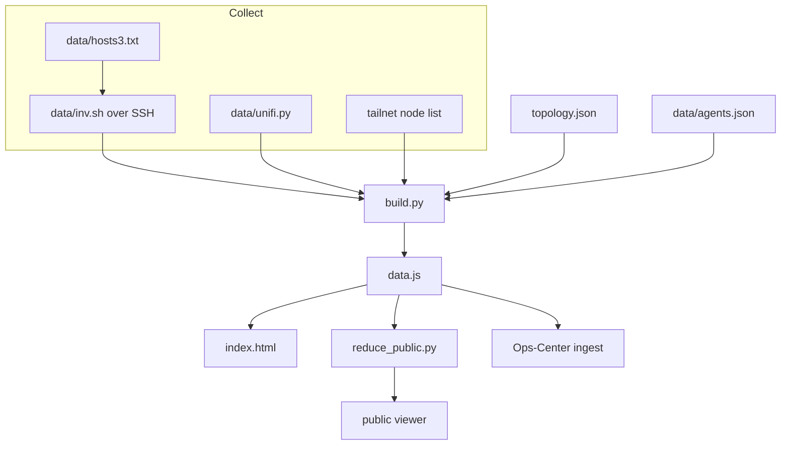

<div align="center">

# fleet-map

Where a fleet's hosts, containers, routes, and agents actually run.

[](LICENSE)


[Quick start](#quick-start) · [Features](#feature-tour) · [Agents](#agents) · [Architecture](#architecture) · [Suite](#part-of-unicorn-commander)

</div>

<p align="center">
  
  <br>
  The fleet map
</p>

## What is fleet-map?

fleet-map is a self-hosted map of a fleet. It draws the machines, the containers and systemd units on them, the routes between them, and the agents that sit on those machines. You keep the shape of the fleet in `topology.json`, and `collect.sh` fills in what is running by SSHing each host and running a read-only inventory.

The viewer is one page, `index.html`, with D3 and a vendored 3D view, served as static files. In the Unicorn Commander suite it is the picture of where the other apps run. The only call this repository makes into the suite is a push of that snapshot to Ops-Center.

## Highlights

- **Four views of one snapshot.** A 3D force graph, a 2D graph, a layer swimlane, and a physical inventory. Same data, same search.
- **Read-only collection.** `collect.sh` runs `data/inv.sh` on each host over SSH: OS, CPU, memory, GPUs, addresses, listening ports, Docker containers with compose labels, and selected systemd units. It does not install or restart anything.
- **Eleven layers.** `build.py` classifies every container and unit into one layer (network, ingress, identity, apps, AI, data, media, mail, observability, dev, platform) so a host opens from hardware down to the service.
- **Agents on the machines that run them.** Each agent is an avatar. Edges go to its seat, voice, wake word, model lane, memory, tools, and channels, coloured by kind and styled by status.
- **The LAN, when you have a controller.** `data/unifi.py` reads a UniFi gateway, switches, access points, ports, and Wi-Fi associations. With no export, LAN lines fall back to the static `lanMembers` list.
- **A privacy toggle, and a reducer that fails closed.** The lock button masks addresses in the browser. `reduce_public.py` is what makes a file safe to publish: it strips fields, scrubs the text, re-scans the result, and writes nothing if a check still matches.
- **Two ways out of the checkout.** `deploy/opscenter-push.sh` posts the full snapshot to Ops-Center. `deploy/public-push.sh` publishes only the reduced file.
- **Search that reaches the inventory.** `/` searches hosts, container names, images, models, hostnames, and ports, in the graph and in the 3D view.

## Feature tour

### The map

<p align="center">
  
  <br>
  The fleet map
</p>

A fresh visit opens the 3D view. A later visit reopens the view you last chose, and `?view=` overrides both. Drag to orbit, scroll to zoom, right-drag to pan, click to select, double-click to open a host. **Graph** is the same layout in D3, with physics you can pause. Hosts expand into groups (by function, or by compose stack) and then into containers. Drag a node to pin it. Double-click a pinned node to release it.

`?view=3d`, `?view=graph`, `?view=lanes`, or `?view=phys` picks a view. `[` and `]` collapse the side panels, `\` toggles both, and `P` is presentation mode (`Esc` leaves it). Service icons load from the [dashboard-icons](https://github.com/homarr-labs/dashboard-icons) set when the browser is online, and the node stays a coloured circle when they do not.

The lines:

| Kind | Meaning |
|---|---|
| `dep` | compose `depends_on` |
| `edge` | Internet edge |
| `route` | Traefik route to an upstream |
| `auth` | SSO / Keycloak |
| `lane` | Inference lane |
| `stream` | Audio or video stream |
| `mail` | Mail |
| `storage` | Backups / git |
| `tailnet` | Tailnet membership |
| `lan` | LAN wired port |
| `wifi` | LAN Wi-Fi association |
| `uplink` | Switch or AP uplink |
| `url` | Public hostname |
| `member` | Host, group, container |
| `agent` | Agent to one of its pieces |

Hand-drawn links live in `topology.json` as `{ "s", "t", "k", "l" }`. `k` has to be a key of `linkLayer` or the viewer drops the line. Tailnet lines come from `tailnetMembers`. LAN lines come from UniFi when `data/unifi.json` exists, and from `lanMembers` otherwise.

### Inventory

<p align="center">
  
  <br>
  The inventory
</p>

**Physical** is a card per host, grouped by site: chassis, where it sits (`physical.building`, `physical.room`, `physical.rack_or_shelf`), power, how many containers and units it runs, and a bar of its layers. Click a card and the right-hand panel lists that host's hardware, OS, public hostnames, and every service.

A container's panel shows image, compose stack, health, published ports, and hostnames. A link's panel shows what the line is for. **Layers view** is the same inventory as a swimlane: one column per host, one row per layer, one dot per service. The network layer opens as its own graph.

Host glyphs (rack, tower, mini, pi, laptop, mac, vps, panel) are inferred from the chassis and role. Set `hosts.<id>.glyph`, or `hosts.<id>.icon` to a PNG, when the guess is wrong.

### Layers

`topology.json` defines the layers. `build.py` assigns each container and unit to one of them by the first matching rule on its name and image.

| Id | Label |
|---|---|
| `network` | Network / edge |
| `ingress` | Ingress / proxies |
| `identity` | Identity / secrets |
| `apps` | Applications |
| `ai` | AI / inference |
| `data` | Data / storage |
| `media` | Media / streams |
| `mail` | Mail / outreach |
| `observability` | Observability |
| `dev` | Dev / CI |
| `platform` | Platform (hardware, OS, runtime) |

Four overlays in the same file (`saas-platform`, `saas-inference`, `prod`, `dogfood`) dim everything that is not tagged. `build.py` applies those tags from container names, images, hostnames, and a host-id list written for the fleet this repository maps. On another fleet the layer colours still work. Edit the tag rules in `build.py` if you want the same filters.

### Agents

`data/agents.json` is the roster. `build.py` resolves each piece to a host, and to a container or systemd unit on that host when the name matches. The viewer draws an avatar from `assets/agents/` and an edge per piece.

| Kind | What the edge means |
|---|---|
| `seat` | Where the agent's process runs |
| `voice` | TTS, STT, and the voice relay |
| `wake` | Wake word |
| `lane` | Which model answers, through which gateway |
| `memory` | Durable memory |
| `tool` | Tools and MCP servers the agent calls |
| `channel` | Rooms and surfaces it speaks on |

A solid edge is `live`, a dashed edge is `configured`, a dotted edge is `unverified`. The layer starts off. Turn it on with the checkbox, or open `?layer=agents`. Guest-tier agents stay hidden until the guest checkbox is on. In the graph view, hover an avatar to isolate its edges. Click it for the piece list. The picture is drawn from `data.js`. Turning the layer on does not call the agents.

### Network

`data/unifi.py` logs in to a UniFi OS controller and issues read-only GETs for devices, clients, networks, and SSIDs. It writes `data/unifi.json`. `build.py` then attaches each fleet host to a switch port or an access point, by MAC, then IP, then name.

**Show network gear** draws the gateway, switches, and APs on the fleet graph. Opening the network layer lists VLANs, SSIDs, and per-port detail. The script never writes to the controller, and it drops passphrase fields. With `UNIFI_PASS` unset it exits without touching an existing `data/unifi.json`, and the map keeps the `lanMembers` mesh.

### Publishing a redacted copy

The lock button (or `?privacy=1`) hides addresses, ports, routes, and client names in the page, and shows sites by their short label. That is a view of the file. `data.js` on disk is unchanged, which is why it is gitignored.

`reduce_public.py` is the gate for a file you are going to serve. It reads `window.FLEET = {...}` and writes a new file that:

- drops host addresses, the tailnet address, the public address, listening ports, UniFi attachment, file-provider routes, physical location, and last-seen
- clears container ports, and keeps a hostname only when it is under `privacy.ownDomains`
- drops the network layer entirely
- drops guest-tier agents, avatar notes, Stable usernames, and piece notes, and strips parentheticals from piece labels
- replaces host ids using `privacy.replace`
- publishes the short site label, and publishes empty `redact` and `replace` tables so the lists themselves are not in the file
- scrubs every remaining string: replace-map text, MAC, IPv4, IPv6, hostnames outside `ownDomains`, redact patterns, `:port`, and long hex runs

It then scans that output. Any hit exits 2 and writes no file. `deploy/public-push.sh` treats that as "publish nothing".

`deploy/build-public-viewer.py` patches `index.html` into a public viewer: privacy forced on, the lock button hidden, `localStorage` and `?privacy=` ignored, agents on unless `?layer=off`, every host that has containers or units expanded unless `?expand=off`, a canonical link to <https://magicunicorn.tech/fleet/>, and `<meta name="robots" content="index,follow">`. Data loads from `data/data.js` with a cache-buster that changes every five minutes. The script copies D3, the 3D bundle, and crew avatars. Guest avatars are left behind. Every patch has to match once. If `index.html` has drifted, the build stops.

To add a name that must not appear on the public map, edit `privacy.redact` or `privacy.replace` in `topology.json`. A pattern that still matches after the scrub stops the publish.

## Quick start

Python 3 is the only dependency. The viewer is the files in the clone.

```bash
git clone https://github.com/Unicorn-Commander/fleet-map.git
cd fleet-map
python3 build.py
./serve.sh
```

Open <http://127.0.0.1:8765/>. `./serve.sh` serves this directory with `python3 -m http.server` on port 8765. Pass another port as the first argument (`./serve.sh 8876`).

`build.py` writes `data.js` next to `index.html`. The page loads that file. A fresh clone has no inventory files, so that first build draws the hosts, sites, links, and agents committed in the repository, and no containers. `.gitignore` already excludes `data.js`. Leave it untracked. It picks up addresses and client names as soon as you collect.

The `topology.json` in this repository is one working fleet. Examples below use stand-in names (`node-a`, `gpu-1`). Put your own hosts in the file. Keep its `layers`, `linkLayer`, and `overlays` arrays. The viewer reads those. Replace `sites`, `hosts`, `links`, `externals`, `tailnetMembers`, and `lanMembers`.

A host entry:

```json
"node-a": {
  "site": "lab",
  "role": "Apps and the ingress proxy",
  "aliases": ["node-a"],
  "glyph": "tower",
  "hardware": { "chassis": "tower" },
  "physical": { "building": "Lab", "room": "Row 1", "rack_or_shelf": "Shelf A" }
}
```

`site` has to be a key of `sites`. The first alias is the name on the map. A link looks like `{ "s": "node-a", "t": "gpu-1", "k": "lane", "l": "inference" }`.

## Run from source

The viewer is the files you cloned. `python3 build.py` then `./serve.sh` is the whole local run.

### Collect a live inventory

`data/hosts3.txt` is one host per line, `id user@address`:

```text
node-a deploy@node-a.example
gpu-1 deploy@gpu-1.example
```

Then:

```bash
./collect.sh
```

`collect.sh` SSHes each line with `BatchMode` and a 12 second connect timeout, runs `data/inv.sh`, and writes `data/inv.<id>.txt`. Those files are gitignored. The remote script prints OS, kernel, CPU, memory, addresses, MACs, GPUs, listening ports, selected active systemd units, `docker inspect` for running containers, and Traefik `Host()` rules it finds on disk. Docker commands are prefixed with `sudo -n` when the SSH user is not root.

The script also has extra SSH commands, after the loop, that fetch a tailnet node list and ingress files from one deployment. Edit or remove those lines for a different fleet. One of those commands re-runs the inventory on a single host with sudo when an environment variable named in `collect.sh` is set. A failed host leaves the others running. `build.py` runs at the end either way.

Set `UNIFI_PASS` (and, if you need them, `UNIFI_URL`, `UNIFI_USER`, `UNIFI_SITE`, `UNIFI_TIMEOUT`) before `./collect.sh` when you want the network layer. `data/unifi.py` can also be run on its own. Then run `python3 build.py` again.

### Publish

Build a public viewer, including a reduced `data/data.js`, in a directory you choose:

```bash
python3 build.py
python3 deploy/build-public-viewer.py /tmp/fleet-public --data data.js
```

Or write only the reduced data file:

```bash
python3 reduce_public.py data.js /tmp/fleet-public-data.js
```

Exit 0 means the file was written. Exit 2 means a leak remained and nothing was written.

| Copy | How this repo publishes it | What a visitor gets |
|---|---|---|
| This checkout | `python3 build.py` and `./serve.sh` | The full snapshot. Privacy is a toggle. |
| Public site | `deploy/public-push.sh` | The reduced file, rsynced to `PUBLIC_SITE_SSH`:`PUBLIC_SITE_DIR`. The page is <https://magicunicorn.tech/fleet/>. |
| Ops-Center | `deploy/opscenter-push.sh` | The full `data.js`, POSTed to `$OPSCENTER_URL/api/v1/fleet/ingest` with `Authorization: Bearer $OPSCENTER_FLEET_TOKEN`. The script exits 0 only on HTTP 200. |
| Office display | `deploy/uc1tv-push.sh` | The reduced file `public-push.sh` already wrote. Rsynced to `UC1TV_SSH`:`UC1TV_DIR`. |

`public-push.sh` and `opscenter-push.sh` refuse a `data.js` older than 30 minutes, so a failed collection is not published as if it were new. `uc1tv-push.sh` applies the same age check to the reduced file and does not reduce on its own. Pass `--collect` to the public or Ops-Center script to run `collect.sh` first.

`public-push.sh` and `opscenter-push.sh` read the checkout in `FLEET_MAP_DIR`, or `fleet-map` in the current user's home directory when that variable is unset. After you change `topology.json` or `privacy`, pull on that host before the next publish.

`deploy/public-push-install.sh`, `deploy/opscenter-push-install.sh`, and `deploy/set-unifi-cred.sh` wire those steps to one existing collector. They contain that deployment's SSH targets. Read them before you run them. The portable interface is the three push scripts and the variables below.

<https://unicorncommander.com/fleet/> redirects to the public page.

## Configuration

Names only. Set the values in the environment of the host that runs the script. Nothing in this table belongs in git.

| Variable | Read by | Meaning |
|---|---|---|
| `UNIFI_URL` | `data/unifi.py` | Base URL of the UniFi OS controller |
| `UNIFI_USER` | `data/unifi.py` | Controller username |
| `UNIFI_PASS` | `data/unifi.py` | Controller password. Unset, the script exits and the map keeps `lanMembers` |
| `UNIFI_SITE` | `data/unifi.py` | UniFi site |
| `UNIFI_TIMEOUT` | `data/unifi.py` | Request timeout, in seconds |
| `OPSCENTER_URL` | `deploy/opscenter-push.sh` | Base URL of the Ops-Center that accepts the snapshot |
| `OPSCENTER_FLEET_TOKEN` | `deploy/opscenter-push.sh` | Bearer token for `POST /api/v1/fleet/ingest` |
| `FLEET_MAP_DIR` | the push scripts | Checkout the push runs in |
| `PUBLIC_SITE_SSH` | `deploy/public-push.sh` | SSH destination for the reduced `data.js` |
| `PUBLIC_SITE_DIR` | `deploy/public-push.sh` | Directory on that host |
| `UC1TV_SSH` | `deploy/uc1tv-push.sh` | SSH destination for the office-display copy |
| `UC1TV_DIR` | `deploy/uc1tv-push.sh` | Directory on that host |

Privacy rules are not environment variables. They live in `topology.json` under `privacy`:

| Key | Meaning |
|---|---|
| `ownDomains` | Hostnames allowed to survive in the public file |
| `replace` | Host id to public id. Applied to ids, and as text, before the scrub |
| `redact` | Patterns replaced with `[client]` |
| `desc` | Sentence the viewer shows when privacy mode is on |

## Architecture



`collect.sh` is the fan-out in front of `inv.sh`, `unifi.py`, and the tailnet fetch. `build.py` is the merge. The browser never talks to a fleet-map server. It reads `data.js`.

| Piece | Role |
|---|---|
| `topology.json` | Sites, hosts, hand-drawn links, layers, overlays, privacy rules, static LAN and tailnet membership |
| `data/agents.json` | Agent roster and the host of each piece |
| `data/hosts3.txt` | SSH targets for `collect.sh` |
| `data/inv.sh` | Read-only inventory the remote host runs |
| `data/unifi.py` | Read-only UniFi export to `data/unifi.json` |
| `collect.sh` | Parallel SSH, then `build.py` |
| `build.py` | Writes `window.FLEET = …` to `data.js`. Standard library only |
| `index.html` | The viewer. D3 v7.9.0 is `d3.v7.min.js`. Three.js r185 and 3d-force-graph are `vendor/fleet3d.bundle.js` |
| `reduce_public.py` | Fail-closed redaction for a public data file |
| `deploy/build-public-viewer.py` | Privacy-forced copy of the viewer |
| `deploy/public-push.sh` | Reduces, then rsyncs the public data file |
| `deploy/opscenter-push.sh` | POSTs the full snapshot to Ops-Center |
| `deploy/uc1tv-push.sh` | Rsyncs the already-reduced file to an office display |
| `tools/keycloak-lockout/` | Separate helper that plans and applies Keycloak brute-force settings |

A fresh `data.js` is a single assignment, `window.FLEET = {…}`, with `hosts`, `containers`, `routes`, `network`, `agents`, `sites`, `links`, `layers`, and `privacy`.

## Part of Unicorn Commander

| App | What it does |
|---|---|
| [Ops-Center](https://github.com/Unicorn-Commander/Ops-Center) | The control plane: tenants, billing, federation, API keys, model routing |
| [Unicorn-Brigade](https://github.com/Unicorn-Commander/Unicorn-Brigade) | The agent layer: agents, tools, memory, orchestration |
| [Unicorn-Stable](https://github.com/Unicorn-Commander/Unicorn-Stable) | Humans and agents in the same room: chat, voice, video |
| [Accounting-Ops](https://github.com/Unicorn-Commander/Accounting-Ops) | Agent-native accounting and books |
| [Contact-Ops](https://github.com/Unicorn-Commander/Contact-Ops) | The shared contact and identity graph |
| [Customer-Ops](https://github.com/Unicorn-Commander/Customer-Ops) | Customers, pipeline, quotes and outreach |
| [Email-Ops](https://github.com/Unicorn-Commander/Email-Ops) | Agent-drafted email with a human approval inbox |
| [Project-Ops](https://github.com/Unicorn-Commander/Project-Ops) | Projects, tasks, time and invoices |
| [Meeting-Ops](https://github.com/Unicorn-Commander/Meeting-Ops) | Recordings, transcripts, summaries and action items |
| [Knowledge-Ops](https://github.com/Unicorn-Commander/Knowledge-Ops) | The wiki and memory your agents ground on |
| [Security-Ops](https://github.com/Unicorn-Commander/Security-Ops) | Authorized security scanning with engagement and attestation gates |
| [Tax-Planning-Ops](https://github.com/Unicorn-Commander/Tax-Planning-Ops) | Tax plans, scenarios and statutory deadlines |
| [Brand-Ops](https://github.com/Unicorn-Commander/Brand-Ops) | Brand kits, marks, voices and rules |
| [Podcast-Ops](https://github.com/Unicorn-Commander/Podcast-Ops) | Episodes, audio QA and publishing |
| [UUDA](https://github.com/Unicorn-Commander/UUDA) | The device agent for your fleet |
| **[fleet-map](https://github.com/Unicorn-Commander/fleet-map)** | **Fleet inventory and topology map** |

`deploy/opscenter-push.sh` is the only call into the suite: it POSTs the snapshot to Ops-Center at `/api/v1/fleet/ingest`. Every other app appears when its container, route, or agent piece is in the inventory. `data/inv.sh` records a running `uc-agent` unit, which is how a UUDA device shows up.

## Development

There is no lint target and no dependency install.

The only automated tests are for the Keycloak helper. It is not on the path that builds the map. `plan` is read-only. Credentials are environment variables named by the target file. See `tools/keycloak-lockout/RUNBOOK.md`.

```bash
python3 -m unittest discover -s tools/keycloak-lockout -t tools/keycloak-lockout
```

`index.html` is the viewer. A change there has to keep `deploy/build-public-viewer.py` green: that script exits if one of its patches matches anything other than once. After a viewer change, rebuild the public copy and commit it in the site that serves `/fleet/`. See [CONTRIBUTING.md](CONTRIBUTING.md).

## Security

Report a vulnerability in private. See [SECURITY.md](SECURITY.md). Do not open a public issue, and do not include a live inventory, a token, or a customer name.

`reduce_public.py` is the check before a data file leaves the machine. Collected inventories stay untracked.

## Licence

fleet-map is released under the GNU Affero General Public License v3.0 or later. The full text is in [LICENSE](LICENSE).

<div align="center">

Built by [Magic Unicorn](https://magicunicorn.tech) · part of [Unicorn Commander](https://unicorncommander.ai)

</div>
